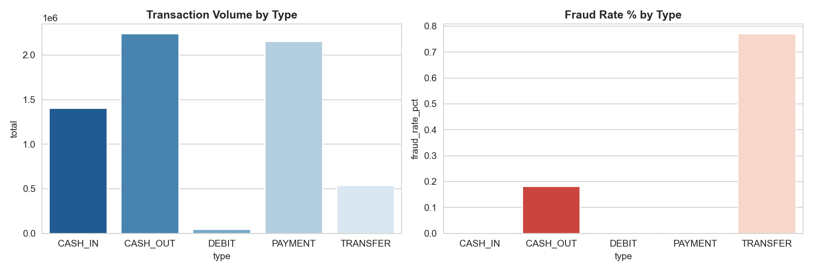
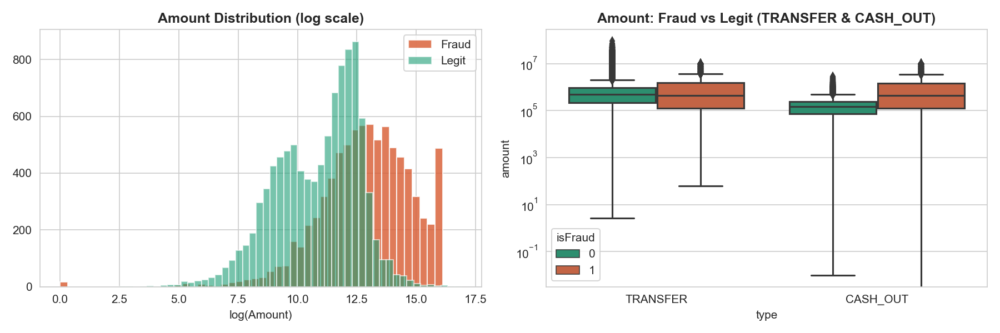
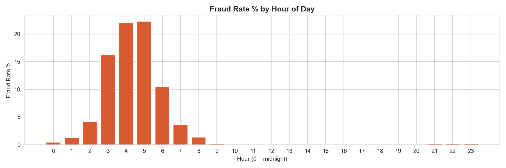
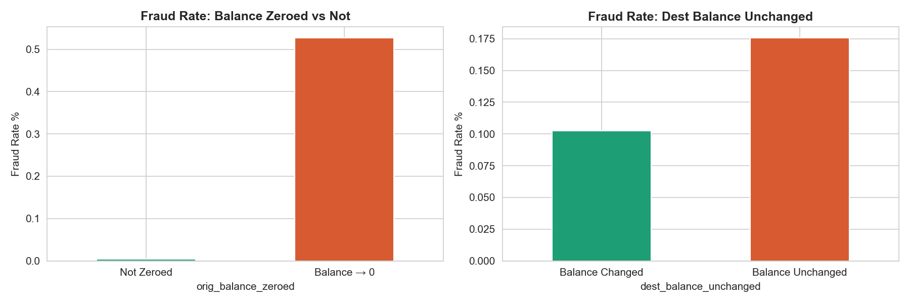
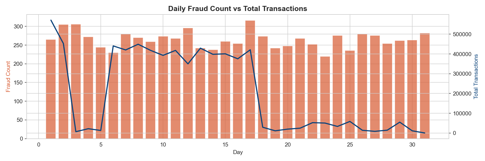
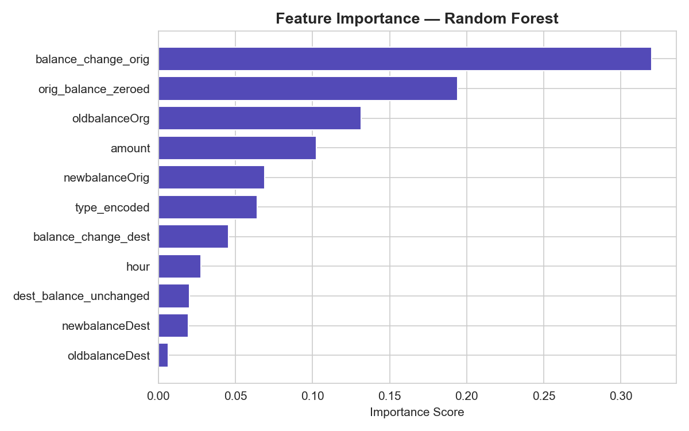

# UPI Payment Fraud Detection

End-to-end fraud analytics pipeline on **6.3 million payment transactions** — exploratory data analysis, SQL risk scoring with window functions, Z-score anomaly detection, and Random Forest classifier.

> **Power BI dashboard in progress**

---

## Key findings

| Finding | Detail |
|---|---|
| Total transactions analysed | 6,362,620 |
| Total fraud cases | **8,213** (0.129% of all transactions) |
| Fraud transaction types | **100% in TRANSFER and CASH_OUT only** — PAYMENT, DEBIT, CASH_IN have zero fraud |
| CASH_OUT fraud rate | 0.184% — 4,116 cases · avg fraud amount ₹14.5L |
| TRANSFER fraud rate | 0.769% — 4,097 cases · avg fraud amount ₹14.8L |
| Balance-zeroing signal | Fraud rate jumps from **0.00% → 53%** when sender balance drops to zero |
| Median fraud amount | **₹4,41,423** vs ₹74,685 for legitimate transactions — 5.9x higher |
| Peak fraud hour | **5:00 AM** — highest fraud rate by hour |
| Existing system detection | Only **16 of 8,213** fraud cases flagged (99.8% miss rate) |
| Z-score model recall | 23% of fraud caught (1,920 cases) |
| Random Forest ROC-AUC | **0.9995** — near-perfect fraud vs legit separation |
| Random Forest recall | **99%** — catches 1,627 of 1,643 fraud cases in test set |

---

## EDA charts

### Fraud by transaction type


### Fraud amount distribution — fraud vs legit


### Fraud rate by hour of day — peak at 5:00 AM


### Balance-zeroing pattern — fraud rate 0% → 53%


### Daily fraud count trend


### Feature importance — Random Forest


---

## Model results

### Random Forest Classifier

| Metric | Score |
|---|---|
| ROC-AUC | **0.9995** |
| Recall (fraud) | **99%** — catches 1,627 of 1,643 fraud cases |
| Precision (fraud) | 15% (pre-tuning — threshold tuning in progress) |
| False alarms | 9,267 (to be reduced via threshold tuning) |
| Train size | 5,090,096 transactions |
| Test size | 1,272,524 transactions |

### Z-score Anomaly Detection (baseline)

| Metric | Score |
|---|---|
| Recall (fraud) | 23% — catches 1,920 fraud cases |
| Precision (fraud) | 3% |
| False alarms | 68,865 |

### System detection gap

| Metric | Value |
|---|---|
| Actual fraud cases | 8,213 |
| Caught by isFlaggedFraud (existing system) | **16** |
| Missed by existing system | **8,197 (99.8%)** |
| Caught by Random Forest (test set) | **1,627 of 1,643** |

> The built-in fraud flag catches 0.2% of actual fraud.
> The Random Forest model catches 99% — a **102x improvement** in detection rate.

---

## SQL window function queries

5 queries written using SQLite to analyse fraud patterns:

| Query | Window function used |
|---|---|
| Fraud rate by transaction type | `GROUP BY` with conditional aggregation |
| 7-day rolling fraud rate trend | `AVG() OVER (ROWS BETWEEN 6 PRECEDING AND CURRENT ROW)` |
| High-risk sender identification | `RANK() OVER (ORDER BY fraud_txns DESC)` |
| Rule-based risk engine | `CASE WHEN` — CRITICAL / HIGH / MEDIUM / LOW |
| System detection gap analysis | `UNION ALL` multi-metric summary |

---

## Feature engineering

4 domain-specific features created from raw columns:

| Feature | Description | Fraud signal strength |
|---|---|---|
| `orig_balance_zeroed` | Sender balance drops to 0 post-transaction | **Very high** — fraud rate 0% → 53% |
| `dest_balance_unchanged` | Receiver balance does not increase | High |
| `hour` | Hour of day (0–23) extracted from step | Medium — peak at 5am |
| `balance_change_orig/dest` | Net balance delta for sender and receiver | Medium |

---

## Project structure

```
upi-fraud-detection/
├── notebooks/
│   ├── upi_fraud_analysis.ipynb    ← all code in one notebook
├── charts/                         ← 6 EDA + model charts
│   ├── 01_fraud_by_type.png
│   ├── 02_fraud_amount.png
│   ├── 03_fraud_by_hour.png
│   ├── 04_balance_patterns.png
│   ├── 05_daily_fraud_trend.png
│   └── 06_feature_importance.png
├── requirements.txt
└── README.md
```

---

## Tools used

| Layer | Tools |
|---|---|
| Data loading & cleaning | Python, pandas, numpy |
| EDA & visualisation | Matplotlib, Seaborn |
| SQL analysis | SQLite (via Python sqlite3) |
| Anomaly detection | scipy (Z-score) |
| ML model | scikit-learn (Random Forest) |
| Dashboard | Power BI Desktop *(in progress)* |

---

## Dataset

- **Source**: Kaggle — Online Payments Fraud Detection Dataset
- **URL**: [kaggle.com/datasets/rupakroy/online-payments-fraud-detection-dataset](https://www.kaggle.com/datasets/rupakroy/online-payments-fraud-detection-dataset)
- **Size**: 6,362,620 rows × 11 columns · ~470 MB
- **Note**: Raw CSV not included in repo (file size limit). Download from Kaggle and place as `PS_20174392719_1491204439457_log.csv` in the root folder.

---

## How to run

```bash
git clone https://github.com/YOURUSERNAME/upi-fraud-detection
cd upi-fraud-detection
pip install -r requirements.txt
jupyter notebook upi_fraud_analysis.ipynb
```

Run all cells top to bottom. Dataset must be in the root folder before running.
